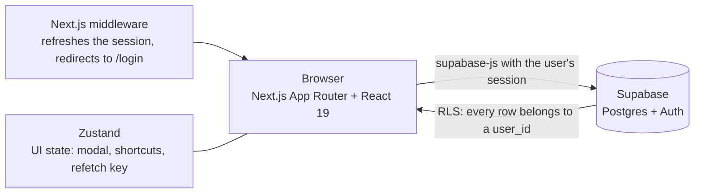

# FinCtrl

Personal finance web app built with Next.js 15 and Supabase: accounts, credit cards, categories, transactions with a keyboard-first workflow, recurring items, income and goals, with Row Level Security on every table. A portfolio project in progress: the AI features (CSV/OFX import with automatic categorization) are planned, not built yet.

## Screenshots

No screenshots or live demo yet: the app has not been deployed. They will be added with the first deployment.

## Why it exists

Spreadsheets are tedious and the finance apps I like (VisorFinance, Mobills) are closed. FinCtrl is my own take on that kind of tool: fast data entry with the keyboard, a dashboard that answers "how much did I spend and where", and a free stack to run it.

## How it works

- **Pages** (`src/app/(app)/`): dashboard, transactions, accounts, categories, credit cards, recurring, income and goals; login and register under `(auth)`.
- **Data access** (`src/lib/hooks/`): one hook per entity talks to Supabase from the client with the signed-in user's session, so the database policies decide what each user can read and write.
- **Schema** (`supabase/migrations/001_initial_schema.sql`): 8 tables (`profiles`, `accounts`, `credit_cards`, `categories`, `transactions`, `recurring`, `goals`, `goal_contributions`), all with RLS enabled. A trigger creates the profile when a user signs up and `supabase/seed.sql` adds the default categories.
- **Pure logic** (`src/lib/utils/`): currency, dates and balance calculations, covered by unit tests.

## Results

Measured on 2026-11-03:

| Check | Result |
|---|---|
| `npx tsc --noEmit` | passes |
| `npm run test:run` (Vitest) | 28 tests passing, 5 files (currency, dates, calculations, types, smoke) |
| `npm run build` | compiles; 11 pages plus the not-found page, and the middleware |
| RLS | enabled on 8 of 8 tables |
| `npm run lint` | 9 errors and 21 warnings, tracked as known debt (see below) |

## Usage

1. Create a free Supabase project and run `supabase/migrations/001_initial_schema.sql` and then `supabase/seed.sql` in its SQL editor.
2. In the app folder, copy `.env.example` to `.env.local` and fill `NEXT_PUBLIC_SUPABASE_URL` and `NEXT_PUBLIC_SUPABASE_ANON_KEY`.
3. `cd finctrl && npm ci && npm run dev`, then open http://localhost:3000 and register a user.

Tests: `npm run test:run`.

## Engineering decisions, trade-offs and known limitations

**Decisions**
- **Web app on Next.js + Supabase, not a desktop app or a rewrite.** Auth, Postgres and row-level security come ready, and everything runs on free tiers. The design notes are in [`docs/superpowers/specs/`](docs/superpowers/specs).
- **RLS is the security boundary.** Every table has a policy tied to the owner (`user_id`), so a client bug cannot read someone else's rows.
- **Keyboard-first data entry.** `Ctrl/Cmd+N` opens the new-transaction modal, `Ctrl/Cmd+D` goes to the dashboard, `Ctrl/Cmd+T` to the transactions, `Esc` closes the modal, and "Save and continue" keeps type, category and account to enter several transactions in a row.
- **Card spending hits the account balance on the purchase date**, not when the bill is paid. This is a product decision that may change.
- **No bank aggregator.** Open Finance providers charge too much for a personal project, so data entry is manual today and CSV/OFX import is the plan.

**Known limitations** (verified in the code; not hidden)
- The consolidated balance downloads every transaction to the browser and sums there. Past the API's default page of 1,000 rows it would be wrong without raising an error; the sum belongs in the database.
- The auth middleware lets requests through if it throws (fail-open). Data stays protected by RLS, but it should redirect to login instead.
- The initial balance of inactive accounts is ignored while their transactions still count.
- The billing period for closing days 29 to 31 can roll into the next month on short months.
- Recurring items are only displayed; they do not generate transactions.
- The 9 lint errors are React 19 rules (state set directly inside effects in six data hooks, components created during render in the recurring page).
- Tests cover only the pure utilities, not the hooks or the UI, and the CI is not set up yet.
- A transaction can reference a category or account of another user; RLS checks the owner of the transaction but not the foreign keys.

## Next steps

- Cleanup: zero lint errors, balance and KPIs aggregated in Postgres, fail-closed middleware, ownership check on foreign keys, CI.
- **AI features**, with the server calling the model and RLS still applied: CSV/OFX import with automatic categorization and a review queue, natural-language entry ("spent 45 at iFood yesterday"), a chat over typed read-only queries, and a monthly summary. They come with an eval of categorization accuracy.
- Deploy on Vercel with a demo user and fictional data, then screenshots here.

## 🇧🇷 Resumo em português

FinCtrl é um app web de finanças pessoais feito com Next.js 15 e Supabase: contas, cartões, categorias, transações com fluxo pensado para teclado, recorrentes, receitas e metas, com Row Level Security em todas as tabelas. É um projeto de portfólio em andamento: as funções de IA (importação CSV/OFX com categorização automática) estão planejadas e ainda não existem.

- **Medido em 03/11/2026:** typecheck sem erros, 28 testes passando (só utilitários puros), build compila, RLS ligado nas 8 tabelas e 9 erros de lint conhecidos.
- **Como rodar:** criar um projeto Supabase (grátis), rodar as migrations de `supabase/`, preencher o `.env.local` e `cd finctrl && npm ci && npm run dev`.
- **Limitações conhecidas (sem esconder):** o saldo consolidado é somado no navegador (erra com mais de 1.000 transações), o middleware deixa passar se falhar, os recorrentes não geram transações e o CI ainda não existe.
- **Próximos passos:** limpeza (lint, agregação no banco, CI), depois as funções de IA com avaliação de acurácia, e por fim o deploy com demo e prints.
